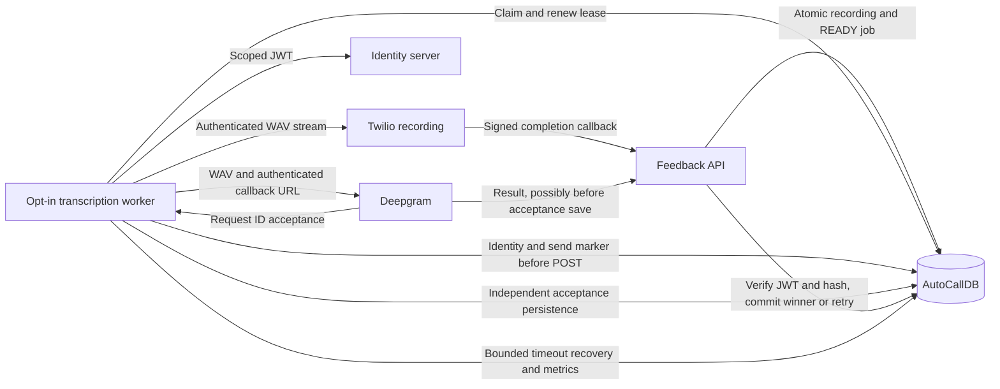

# Asynchronous Deepgram Transcription

## Guide Navigation

- [Deployment And Readiness](#deployment-and-readiness)
- [Configuration Reference](#configuration-reference)
- [Job Creation](#job-creation)
- [Callback Contract](#callback-contract)
- [Payload And Persistence](#payload-and-persistence)
- [Data And Implementation](#data-and-implementation)
- [Database Lifecycle](#phase-1-database-lifecycle)
- [Provider Clients](#phase-2-provider-clients)
- [Worker And Capacity](#phase-3-worker)
- [Durable State Outcomes](#durable-state-outcomes)
- [Metrics](#metrics)
- [Operator Recovery](#operator-recovery)
- [Reviewed Retranscription](#reviewed-retranscription)
- [Verification](#verification)

This is the current transcription reference through Phase 4. Phase sections
retain implementation history; the deployment checklist and state tables describe
the current contract. Related guides: [documentation index](../README.md),
[auto-call worker](../autocall/README.md), [Twilio endpoints](../twilio_endpoints.md)
and [flow contract](../twilio_flow_contract.md).

## Scope And Flow

Audio stays at Twilio. An accepted recording-completed callback creates a READY
transcription job. The opt-in TranscriptionWorker claims it and uses the submission
service to stream audio to Deepgram's prerecorded API, supplies a callback URL, and records
the returned request ID. Deepgram later posts the result to this API. The callback
does not download audio, contact Deepgram or perform business actions. Callback SQL
atomically schedules an allowlisted transient failure for retry; the worker performs
the later upload, never the callback request itself.
Enqueueing, provider clients, durable submission coordination and worker recovery/retry
orchestration are implemented. Provider access and the hosted worker default to disabled.

Migration 018 now supplies the database claim/submission/recovery lifecycle described
under Phase 1 below. Phase 2 implements the C# provider clients and revised JWT
contract. Migration 019 adds global outstanding-capacity reservations and the fenced
lease-token projection for the Phase 3 worker; installing migrations does not enable it.
Migration 020 adds read-only metrics and audited operator retranscription. Phases
0-4 are implemented and locally verified. Live canary/production connectivity and
retention cleanup are not implemented or certified by those local tests.

Schema migration `database/010.sql` defines logical jobs, independent submissions,
and recording/submission-linked utterance rows with explicit millisecond timing.
Deploy `database/011.sql` for callback persistence and a nullable callback payload hash.
Deploy `database/012.sql` after 011 to replace the recording-status procedure with
atomic transcription enqueueing. Do not redeploy the older procedure from 008 afterward.



## Deployment And Readiness

1. Apply the repository's ordered AutoCallDB migrations through
	[020](../../database/020.sql). Transcription prerequisites are
	[010](../../database/010.sql), [011](../../database/011.sql) and
	[012](../../database/012.sql), followed by shared auto-call migrations 013-017
	and transcription [018](../../database/018.sql),
	[019](../../database/019.sql) and 020. Fresh databases also need schema 001 and
	all preceding applicable migrations. Do not overwrite newer procedures with
	older migrations: 008 removes atomic enqueueing, 011 removes the newer callback
	policy, and 018 removes 019's claim cap/context projection when applied afterward.
2. Configure the feedback API's central database pool and callback JWT trust.
	Deploy its public HTTPS callback route before any producer upload. Verify the
	external URL/path prefix and that ingress preserves Authorization, permits an
	8 MiB JSON body, and does not log credentials or redirect the callback.
3. Configure the producer's central `ConnectionStrings:AutoCallDB`, identity,
	Twilio media credentials and Deepgram secret. API pool and producer must point
	to the same database. Transcription does not use tenant routing/Redis.
4. Keep `Transcription:Enabled=false` and `Transcription:Worker:Enabled=false`
	during deployment. Recording callbacks can still enqueue READY jobs while
	transcription is disabled; monitor that backlog rather than assuming no work
	exists. Existing Normal/Step/AutoCall workers have independent enablement.
5. Before an approved canary, verify real permission ID, issuer/audience, asymmetric
	algorithm/JWKS rotation, issued token lifetime, account/media access, WAV channels,
	regional provider endpoint and public callback delivery. Obtain recording consent,
	data-processing/region approval and duplicate-billing approval.
6. Only after approval enable both transcription flags, retaining upload concurrency
	one and a uniform outstanding limit across replicas. Observe persistence before
	POST, request identity, callback completion/winner, backlog and metric freshness.
	Mock/SQL success is not evidence of live provider interoperability.

To stop new submissions, disable both flags in deployment configuration and restart
the host (settings are read for its lifetime). Shutdown drains/cancels worker tasks;
persisted send markers still mean possible provider acceptance. Leave the callback
API and identity verification available for outstanding and late results. Disabling
the worker does not cancel provider processing, clear jobs or stop enqueueing.

## Configuration Reference

Producer settings live in the C# `Transcription` section. Use secret injection,
not committed values. Environment overrides replace each colon with double
underscores, for example `Transcription__Identity__PermissionId`. The callback API
uses separate settings in [Responses And Operations](#responses-and-operations);
producer trust does not configure the API. Match issuer, audience, permission and
algorithm on both sides.

| Producer key | Default / requirement |
| --- | --- |
| Transcription:Enabled | false; provider coordination, not worker registration |
| Transcription:CallbackUrl | https://feedback.example.com/webhooks/deepgram/transcriptions/completed; replace with the real public route including any ingress prefix |
| Transcription:DeepgramBaseUrl | https://api.deepgram.com; approved HTTPS regional origin with root path; no query, fragment or credentials |
| Transcription:DeepgramApiKey | Empty; required secret when enabled |
| Transcription:SubmissionTimeoutSeconds | 600; whole submission deadline; allowed 1-3600 |
| Transcription:MediaHeaderTimeoutSeconds | 30; allowed 1-120 |
| Transcription:MaxDurationSeconds | 3600; allowed 1-86400 |
| Transcription:MaxAudioBytes | 134217728 (128 MiB); allowed 44-1073741824 |
| Transcription:RequireModelImprovementOptOut | true; require snapshot mip_opt_out=true; changing policy needs data-processing approval |
| Transcription:Identity:BaseUrl | http://172.27.112.243:8085; HTTP requires explicit opt-in; prefer approved HTTPS |
| Transcription:Identity:JwtJwksPath | /.well-known/jwks.json; configured identity origin only |
| Transcription:Identity:AllowInsecureIdentityHttp | false; restricted issuance/JWKS exception, never provider/callback HTTP |
| Transcription:Identity:SignInName | Empty; required secret-backed identity login |
| Transcription:Identity:Password | Empty; required secret |
| Transcription:Identity:PermissionId | Empty; required exact positive-decimal ID; no sample/default permission |
| Transcription:Identity:Issuer | sentineldna.com |
| Transcription:Identity:Audience | sentineldna.com |
| Transcription:Identity:Algorithm | RS256; only RS256 or ES256 |
| Transcription:Identity:TokenValidityMinutes | 120 target; allowed 1-1440; cannot extend server-issued expiry |
| Transcription:Identity:TimeoutSeconds | 30; allowed 1-120 |
| Transcription:Twilio:AccountSid | Empty; required AC-prefixed SID matching the recording account |
| Transcription:Twilio:ApiKeySid | Empty; optional SK-prefixed API key SID, preferred with ApiKeySecret |
| Transcription:Twilio:ApiKeySecret | Empty; required secret when ApiKeySid is supplied |
| Transcription:Twilio:AuthToken | Empty; required fallback secret only when no ApiKeySid is supplied |

Configured callback URLs must be credential-free HTTPS without query/fragment,
on port 443, 8080 or 8443. The client supplies Basic correlation/JWT credentials
only for the provider request; never commit that resulting URL. Deepgram API keys
and identity passwords are not required by the callback API. Twilio media credentials
are separate from the API's Twilio webhook-signature configuration.

Model/version/language/detection and output flags belong to immutable job
`ConfigurationJSON`, not mutable producer options. Supply model, version, utterances,
multichannel, diarize, punctuate, smart_format, mip_opt_out and fixed language or
enabled language detection; unsupported, missing or duplicate properties fail closed.
`utterances` and `multichannel` must be true; output flags are JSON booleans, not
strings. Model/version/language tokens are 1-100 ASCII letters, digits, hyphens,
underscores or dots. The client requires mip_opt_out=true under the default policy;
operator retranscription SQL always requires it, even if the client policy is changed.
`latest` selects the provider's current model version at submission time, not a
pinned binary revision. Retain returned metadata for reproducibility.

Worker defaults/lease constraints are in [Phase 3 Worker](#phase-3-worker).
Metrics use `Transcription:Metrics:Enabled=true`, `RefreshSeconds=60` and
`MaxSampleAgeSeconds=120`; refresh is 1-3600 seconds, maximum age must be at least
refresh and no more than 7200 seconds. SQL per-job policy, not worker settings,
owns MaxAttempts, MaxJobAgeMinutes, CallbackWaitMinutes, RetryBaseSeconds and
RetryMaxSeconds. Existing job policy/snapshots are not rewritten on host restart.

## Job Creation

`dbo.automatedcalls_RecordingStatus` creates the job in the same transaction as
recording metadata and its audit event, only when a `completed` status is applied.
Each recording gets its own job, including a completion-first callback or a zero-duration
recording. Call completion itself does not enqueue work. Invalid callbacks,
in-progress/absent/failed statuses, and ignored terminal conflicts do not enqueue.
If job creation fails, metadata and the event roll back, and the webhook returns
an error so Twilio can retry rather than acknowledging unscheduled work.

The API freezes the following immutable configuration snapshot as version 2 for
new recording-completed jobs:

```json
{"model":"nova-3","version":"latest","language":"en","utterances":true,"multichannel":true,"diarize":false,"punctuate":false,"smart_format":false,"mip_opt_out":true}
```

The SQL procedure accepts optional trusted `@TranscriptionConfigurationVersion`
and `@TranscriptionConfigurationJSON` arguments; the HTTP callback does not accept
these settings from Twilio. Use a new version when intentionally changing configuration.
Direct SQL callers must explicitly supply complete versioned options: migration 012's
legacy procedure defaults remain version 1. Existing jobs are never rewritten or
backfilled. The Phase 2 client rejects incomplete snapshots before creating a submission;
review legacy jobs explicitly before enabling the Phase 3 worker.
Jobs start READY with zero attempts, no lease or submission, and availability at
creation time. Existing jobs with the same recording/provider/version are preserved.
Repeated completed callbacks neither reset jobs nor create another configuration
version. Retranscription requires a separate explicit operation, not replaying a
recording callback. Historical completed recordings are not backfilled by migration 012.

## Callback Contract

`POST /webhooks/deepgram/transcriptions/completed`

The callback uses HTTP Basic authentication: username is the submission's
`CorrelationId` UUID; password is an asymmetrically signed JWT from the existing
identity server. Do not assume Deepgram can obtain the JWT or attach a custom Bearer
header. Its documented Basic-auth callback URL is:

```text
https://<correlationId>:<JWT>@feedback.example.com/webhooks/deepgram/transcriptions/completed
```

The credential identifies the submission, so no query parameter is necessary.
Query parameters are rejected. This producer permits HTTPS callback ports 443,
8080 and 8443 only, even though Deepgram also documents HTTP port 80.
Do not log or persist credential-bearing URLs. Deepgram's optional `dg-token` is
supplementary only; it does not replace JWT validation.

Required JWT claims are `iss`, `aud`, `exp` and `permissions`. Permissions are
comma-separated positive decimal IDs; complete trimmed entries must match the
configured feature permission ID exactly. No custom identity claims, `scope` or
`jti` are required. The issuer, audience and signing algorithm are
configured explicitly; only RS256 or ES256 are accepted. A configured public key
or trusted JWKS endpoint supplies verification keys. HTTPS is required unless the
explicit identity HTTP exception below is enabled. Token-provided key URLs
are never used. The signing private key stays at the identity server.

Before contacting Deepgram, the submission service stores SHA-256 of the exact JWT text
in `CallbackTokenHash`. The API verifies the JWT, looks up the Basic correlation UUID,
requires the exact stored hash, and derives recording identity from the trusted database
row, not token or payload claims. Tokens remain reusable for authenticated retries
until expiry. Expiry must cover upload, provider queue/processing, callback retries,
and a margin. SQL callback deadlines and JWT expiry are independent; expired tokens
are rejected even for otherwise eligible late results. Recovery and reviewed
retranscription are implemented in [Phase 4](#phase-4-failure-recovery-and-operations);
there is no provider transcript-retrieval reconciliation or JWT-expiry bypass.

## Payload And Persistence

Accept `application/json` bodies up to 8 MiB and at most 20,000 utterances.
Success uses Deepgram's prerecorded response:
`metadata.request_id`, `metadata.channels`, `metadata.duration`, `results.channels`, and
`results.utterances` (enable `utterances=true` when submitting). For non-empty speech,
utterances are required rather than inventing segmentation. Each utterance stores
its channel, text, confidence, and word metadata. Fractional-second offsets are
rounded to integer milliseconds. Channel counts must match the recording. A silent
result may have zero utterances and completes with zero transcript rows.
The channel array must match the submitted multichannel option. ProviderModel
comes from the immutable configuration snapshot; detected channel language takes
precedence over configured language. Original provider metadata stays in ResponseJSON.

Provider error callbacks use `request_id`, `err_code` (uppercase letters, digits
and underscores), and `err_msg`. LastErrorCode stores the validated code and
LastErrorMessage uses a generic description; provider error text is not logged.
Raw authenticated
JSON is stored on the submission for diagnosis and retention-controlled access.

Callback persistence locks the job and submission in a consistent order and commits
the response, callback hash/receipt time, submission outcome, transcript rows and
winning job outcome in one transaction. Canonical JSON hashing makes retries with
different object-key order or whitespace equivalent. Duplicate callbacks return 204
without changing saved data; conflicting finalized callbacks return 409 without
overwriting the first result. Provider request IDs must match when already known.
An early callback can populate the request ID before acknowledgement is recorded.
Worker acknowledgement never regresses a finalized submission/job.

The first valid success may win while the job is READY, PROCESSING or WAITING_CALLBACK,
including from a TIMED_OUT submission. No active worker lease is required for callback
processing. COMPLETED winners are immutable; FAILED jobs are not reopened. With
migration 018, valid late success may complete DEAD_LETTER; credential expiry applies.
Nonwinning late responses are retained on their submissions but do not add displayed
transcripts or change the selected result. A provider failure marks the current
active attempt for retry with backoff when allowlisted as transient (or DEAD_LETTER
when budgets expire); other failures become permanently FAILED. Failures from older
attempts do not terminate newer work. Call, queue, and recording statuses are unchanged.

## Data And Implementation

| Table | Purpose / invariants |
| --- | --- |
| AutomatedCallRecordings | Trusted call/account/recording SID, completion, duration and channel metadata; audio remains at Twilio |
| AutomatedCallTranscriptionJobs | Logical recording/provider/configuration-version identity, immutable options, finite policy, lease/current attempt and terminal winner |
| AutomatedCallTranscriptionSubmissions | Independent numbered attempts with immutable correlation/submission-token, JWT hash/expiry, send marker, request ID/deadline and callback audit |
| AutomatedCallTranscripts | Winning provider utterances linked to recording/submission, explicit AudioChannel and integer millisecond offsets; legacy rows are not reinterpreted |
| AutomatedCallTranscriptionOperations | Reviewed retranscription source/new job IDs, operator/reason/time; preserve references in retention planning |

Consumers select the intended recording/provider/configuration version and join
its `CompletedSubmissionId` to transcript `SubmissionId`. Never select all transcript
rows for a recording without version/winner selection. `CompletionOrigin=EMPTY`
has no provider winner or transcript rows; provider silence can also have zero rows
but uses `CompletionOrigin=PROVIDER`. Zero rows alone do not distinguish successful
silence, local empty completion, pending work and failure. No transcript read API,
business-action integration or automatic retention deletion is introduced here.

| Owning code | Responsibility |
| --- | --- |
| [Worker](../../apps/notification-workflow-service/NotificationWorkflowService/TranscriptionWorker.cs) | Poll, recovery, capacity, leases, cancellation/shutdown and dispositions |
| [Provider contracts/settings](../../apps/notification-workflow-service/NotificationWorkflowService/Service/Transcription/TranscriptionContracts.cs) | Options, safe result types and provider/repository interfaces |
| [Worker settings](../../apps/notification-workflow-service/NotificationWorkflowService/Service/Transcription/TranscriptionWorkerOptions.cs) | Independent limits and lifecycle repository contract |
| [Submission coordinator](../../apps/notification-workflow-service/NotificationWorkflowService/Service/Transcription/TranscriptionSubmissionService.cs) | Token/media preparation, persisted identity/marker, single POST and independent acceptance save |
| [Identity client](../../apps/notification-workflow-service/NotificationWorkflowService/Service/Transcription/CallbackTokenClient.cs) | Scoped JWT acquisition, pinned JWKS and signature/permission/lifetime validation |
| [Twilio media client](../../apps/notification-workflow-service/NotificationWorkflowService/Service/Transcription/TwilioRecordingClient.cs) | Direct authenticated bounded WAV stream and explicit channel/header validation |
| [Deepgram client](../../apps/notification-workflow-service/NotificationWorkflowService/Service/Transcription/DeepgramClient.cs) | Snapshot-driven POST and definite versus uncertain acceptance classification |
| [SQL adapter](../../apps/notification-workflow-service/NotificationWorkflowService/Repository/TranscriptionSubmissionRepository.cs) | Typed async central procedures and immutable/fenced identity |
| [Metrics](../../apps/notification-workflow-service/NotificationWorkflowService/Service/Transcription/TranscriptionMetrics.cs) | Tag-free bounded refresh and stale-sample suppression |
| [Callback route](../../apps/notification-feedback-api/app/routes/deepgramTranscriptions.js) | Public route, trust settings and bounded JSON parser |
| [Callback authentication](../../apps/notification-feedback-api/app/middleware/requireDeepgramCallbackJwt.js) | Basic parsing and asymmetric JWT verification |
| [Callback controller](../../apps/notification-feedback-api/app/controllers/deepgramCallbackController.js) | Stored hash/recording binding and durable response handling |
| [Normalization](../../apps/notification-feedback-api/app/utils/deepgramTranscription.js) | Payload validation, canonical hash, channels and millisecond utterances |
| [Shared API repository](../../pkg/repository/automatedCallRepository.js) | Atomic recording enqueue snapshot and typed callback SQL calls |

The producer streams directly from Twilio's authenticated recording resource. It
does not call `GET /api/v1/auto-call/recordings/:recordingId/content`, write local
audio files, transcode or silently downmix. That internal endpoint is a separate
recording-access workflow documented in [Twilio endpoints](../twilio_endpoints.md).

## Responses And Operations

| HTTP | Meaning |
| --- | --- |
| 204 | Persisted success/failure, duplicate, or retained nonwinning late response. |
| 400 | Invalid JSON/callback payload or unexpected query parameters. |
| 401 | Missing/invalid/expired JWT or credentials, claims binding, unknown submission, or stored token mismatch. |
| 409 | Provider request-ID mismatch or conflicting finalized payload. |
| 413 | Callback JSON exceeds 8 MiB. |
| 415 | Unsupported content type. |
| 500/503 | Persistence or verification configuration/key service unavailable; retry. |

Mount this public webhook before general bearer middleware, with its own JWT
authentication and bounded JSON parser. Rate limits and TLS belong at ingress.
Do not log authorization headers, tokens, callback URLs, transcript text, or raw
payloads. Deepgram retries non-2xx callbacks, so return 204 only after durable commit.

Configuration uses `DEEPGRAM_CALLBACK_JWT_ISSUER`, `DEEPGRAM_CALLBACK_JWT_AUDIENCE`,
`DEEPGRAM_CALLBACK_PERMISSION_ID` (required; no inferred/default permission),
`DEEPGRAM_CALLBACK_JWT_ALGORITHM` (default `RS256`), and either
`DEEPGRAM_CALLBACK_JWT_PUBLIC_KEY` (PEM) or `DEEPGRAM_CALLBACK_JWKS_URL` (HTTPS).
Alternatively set `DEEPGRAM_IDENTITY_BASE_URL` and `DEEPGRAM_IDENTITY_JWKS_PATH`
(default `/.well-known/jwks.json`). `DEEPGRAM_IDENTITY_ALLOW_HTTP=true` explicitly
permits only the exact base host/port and configured JWKS path; other HTTP URLs and
redirects are rejected. Configure issuer and audience as `sentineldna.com` for the
agreed identity server, independently of its network address.
`AUTO_CALL_DATABASE` selects the strict database pool and defaults to AutoCallDB.
Missing trust configuration fails closed. Deepgram's outbound API key is not needed
by the callback endpoint.
JWT verification permits five seconds of clock skew. JWKS fetches use a five-second
timeout, a 64 KiB response bound and cached keys; publish overlapping keys during identity-server rotation.
An unknown signing key or invalid signature is rejected, never accepted on key-service failure.

Equivalent configuration-file keys are under `deepgram.callback`: `issuer`, `audience`,
`permissionId`, `algorithm`, `publicKey`, `jwksUrl`, `identityBaseUrl`, `jwtJwksPath`
and `allowInsecureIdentityHttp`. Environment settings take precedence.
Database selection falls back to `twilio.database` and then AutoCallDB; a missing
named pool never falls back to another database.

Follow the [deployment checklist](#deployment-and-readiness) through migration 020,
configure identity trust and expose the route through TLS/rate-limited ingress.
The submission service persists identity, JWT hash/expiry and
the one-shot send marker before uploading audio. The worker claims jobs, renews leases
and interprets submission outcomes only when explicitly enabled. While disabled,
there are no automatic transcription submissions. Raw responses and transcript text
contain sensitive recording content; apply database access and retention controls.

## Verification

Run from the repository root after installing the workspace's existing pnpm and
.NET dependencies. Fast HTTP/worker tests make no live provider requests:

```powershell
dotnet test apps/notification-workflow-service/NotificationWorkflowService.Tests/NotificationWorkflowService.Tests.csproj --filter 'FullyQualifiedName~TranscriptionHttpTests|FullyQualifiedName~TranscriptionWorkerTests'
pnpm --dir apps/notification-feedback-api exec mocha --timeout 10000 test/deepgramCallback.test.js
```

For durable recovery/races, use the existing owned, isolated LocalDB database with
all migrations through 020 and an idle transcription queue. Never point tests at
a deployment database. Without the exact opt-in connection, SQL C# tests skip;
skips do not satisfy the recovery gate. Do not run transactional SQL suites and
committed concurrency fixtures in parallel.

```powershell
SqlLocalDB start NotificationWorkflowVoiceTests
$env:AUTOCALL_TEST_SQL_CONNECTION = 'Server=(localdb)\NotificationWorkflowVoiceTests;Database=NotificationWorkflowVoiceTests;Integrated Security=true;TrustServerCertificate=true'
dotnet test apps/notification-workflow-service/NotificationWorkflowService.Tests/NotificationWorkflowService.Tests.csproj --filter 'FullyQualifiedName~Transcription|FullyQualifiedName~AutoCall|FullyQualifiedName~WorkflowOrchestrationCompatibility'
pnpm --dir apps/notification-feedback-api exec mocha --timeout 10000 test/autoCall.test.js test/deepgramCallback.test.js test/twilioRecordingStatus.test.js test/twilioRecordings.test.js
sqlcmd -S "(localdb)\NotificationWorkflowVoiceTests" -E -I -b -d NotificationWorkflowVoiceTests -i database/test/deepgramCallback.test.sql
sqlcmd -S "(localdb)\NotificationWorkflowVoiceTests" -E -I -b -d NotificationWorkflowVoiceTests -i database/test/transcriptionLifecycle.test.sql
sqlcmd -S "(localdb)\NotificationWorkflowVoiceTests" -E -I -b -d NotificationWorkflowVoiceTests -i database/test/transcriptionSchema.test.sql
SqlLocalDB stop NotificationWorkflowVoiceTests
```

All other guarded scripts under [database/test](../../database/test/)
form the shared auto-call SQL regression gate; run them sequentially too when
changing shared procedures/schema. Confirm fixtures are removed before stopping
LocalDB. Do not enable workers, relax database guards or call providers to run tests.

Tests use generated RSA/ECDSA keys and mocked HTTP repository calls. The SQL suite
runs only in owned scratch databases, exercises winner/retry/terminal policies and
forces transcript-write rollback; it removes its fixtures. Production identity-server
and Deepgram connectivity still require a deployment smoke test.

Provider reference: https://developers.deepgram.com/docs/callback.

## Phase 0 Worker Contract

Status: agreed design decisions. Phase 1 implements the database portion and Phase 2
implements provider configuration/authentication and submission coordination. The hosted
worker and retry orchestration are implemented in Phase 3 but remain opt-in. Retention
cleanup is not implemented.

### Authentication

- Configure an identity base URL and `jwtJwksPath`, initially
	`http://172.27.112.243:8085` and `/.well-known/jwks.json`. Resolve the configured
	path against the trusted base URL, never against token-provided URLs.
- Configure the fixed permission ID granted by the identity server. Its display
	mapping may be `deepgram-transcription-feature`; authorization checks the actual
	ID, not its display text. The JWT `permissions` claim is a comma-separated string
	of positive decimal IDs. Split on commas and match complete trimmed IDs exactly;
	permission `12` must not match `112`. Missing/malformed permissions or a missing
	required permission fail closed. The actual feature permission ID is deployment
	configuration; do not infer it from the example token or use a permissive default.
- JWTs do not contain `submission_id` or `recording_id`. Keep signature, issuer,
	audience, expiry and permission validation. Use the Basic username correlation
	UUID to look up the submission; require SHA-256 of the exact JWT to match its
	stored credential hash, and derive recording identity from that trusted row.
	Do not trust a recording ID from the callback body as authentication evidence.
- Require `iss`, `aud`, `exp` and `permissions`; the supplied token has no `jti`,
	so it is not a required claim. Validate issuer and audience as `sentineldna.com`,
	configurable independently of the identity server's HTTP base URL. A `scope`
	claim is not required. Keep an explicit asymmetric algorithm allowlist (RS256
	or ES256); confirm the deployed algorithm/key compatibility during integration.
- Target configurable JWT validity of 120 minutes. Identity-server issuance must
	support this; a worker setting cannot extend a signed token's expiry. Obtain a
	token with sufficient remaining validity before marking a submission sendable.
- Reuse POST `accounts/authenticate2` relative to the configured identity base URL,
	with JSON `{signInName,password}` and response `{isSuccessful,jwt}`. Require
	`isSuccessful: true` and a nonempty JWT. Supply credentials through secrets, not
	committed application settings. The JWKS path supplies verification keys, not tokens.
- Internal HTTP token issuance and JWKS retrieval are explicitly approved for now.
	Setting `AllowInsecureIdentityHttp` defaults false and must be enabled
	for this deployment. Restrict the exception to the configured identity host,
	port and paths; reject redirects and token-provided key URLs. Do not apply it to
	Deepgram or public callback ingress, which remain HTTPS. The accepted residual
	risks are credential interception and verification-key substitution; a private
	IP alone does not prevent them. Prefer HTTPS when available. Both the C# client and
	callback API require independent explicit opt-in for this exception.
- Replace a provably unsent submission after restart with a fresh correlation ID
	and token on the same logical job. Preserve prior audit records and credential
	hashes. Do not change the credential on an already-sent submission.

### Lifecycle And Recovery

- Every completed recording is eligible and gets its own job, including multiple
	recordings for one call. This is a new application; no historical backfill is planned.
- Zero-duration recordings complete locally with zero transcript rows and explicit
	EMPTY completion origin, without fabricating a Deepgram request ID or response.
	Migration 018 supplies the constraint/procedure and Phase 3 implements the worker path.
- Five maximum submission attempts; claims and renewals do not consume attempts.
	Stop creating submissions after a configurable total job age of 24 hours.
	Preparation retries also need bounded backoff and the total-age guard.
- Accepted submissions wait 60 minutes from acknowledgement for a callback.
	Ambiguous submissions wait 60 minutes from the durable send marker before retry.
	Lease expiry or restart alone never authorizes an immediate ambiguous resend.
- Missing callbacks and ambiguous acceptance may trigger a fresh submission;
	duplicate provider processing and billing are accepted. Keep each submission's
	identity and credential hash so an authenticated older result can still win.
- Retry rate limits, provider outages and transient media failures. Implemented
	exponential backoff with jitter: 30-second initial ceiling, capped at 15 minutes.
	Treat permanently missing media, invalid audio and invalid configuration separately;
	do not blindly retry them. Surface authentication/configuration failures to operators.
- Retryable failures return to READY with a future AvailableAt. FAILED is permanent;
	exhausted retry/age budgets use DEAD_LETTER. A valid late success may complete a
	DEAD_LETTER job, subject to token validity; existing COMPLETED winners are immutable.
	Reopening permanently FAILED jobs is not approved by this decision.
- Callback deadlines do not invalidate otherwise valid late credentials. JWT expiry
	remains enforced, so a 120-minute token does not authorize callbacks indefinitely.
- Deepgram request lookup provides request/usage metadata, not recoverable transcripts.
	Async results are deleted after callback delivery or exhausted retries. No documented
	prerecorded submission idempotency mechanism was found; recovery uses resubmission.

### Tunable Initial Defaults

These defaults are implemented in application settings, new version-2 snapshots or
SQL per-job policy unless explicitly marked proposed. Retention periods remain
proposals, not cleanup automation. Freeze effective options per job/configuration
version; tuning must not mutate queued jobs or submissions.

| Setting | Initial value |
| --- | --- |
| Worker enabled | false; enable only for the canary |
| Upload concurrency / outstanding submissions | 1 / 10 |
| Audio | Authenticated Twilio WAV streaming; preserve recorded channels |
| Channel fallback | No silent downmix; fail explicitly on a mismatch |
| Model / model version | nova-3 / provider latest; retain returned model metadata |
| Language | en; configurable fixed language or supported detection mode |
| Utterances / multichannel | true / true |
| Diarization / punctuation / smart formatting | false / false / false |
| Model improvement | Opt out with mip_opt_out=true |
| Deepgram endpoint | https://api.deepgram.com; configurable trusted regional endpoint |
| Maximum recording duration / upload bytes | 60 minutes / 128 MiB |
| Media header timeout / overall submission timeout | 30 seconds / 10 minutes |
| Callback body / utterance limits | Existing 8 MiB / 20,000 |
| Raw response / normalized transcript retention | Proposed 30 days / 90 days |

Retention cleanup must preserve submission identity, credential hashes and winning
references needed by live jobs and late callbacks. Never delete active work to meet
a retention target. These periods do not authorize automatic Twilio audio deletion.
If a required regional endpoint is selected, do not silently fall back to another
region. Provider opt-out can affect pricing; verify it in the live canary.

Phase 0 authentication and lifecycle design decisions are settled. Before enabling
the worker, supply the actual feature permission ID, secret-backed login credentials
and signing-algorithm configuration, and verify issuance lifetime/JWKS compatibility
against the deployed identity server. Do not invent a permission ID from the sample.
Phase 2 replaces the old scope/custom-claim requirements with permission-ID validation
and the restricted HTTP policy. Phase 3 implements hosted-worker orchestration;
retention cleanup remains future work.

## Phase 1 Database Lifecycle

Deploy `database/018.sql` after 017 (and the transcription prerequisites 010-012).
Use the same ordered migrations for a fresh database after schema 001. Do not
redeploy 011 afterward: it would restore the old callback terminal/failure policy.
No existing recording, call or enqueue procedure is changed by 018.

The migration adds CurrentSubmissionId with a same-job foreign key, persisted
per-job recovery settings, immutable SubmissionToken/CreatedLeaseToken identity,
send-start and token-expiry timestamps, and an explicit EMPTY completion origin.
On first upgrade, AttemptCount is normalized to the number of stored submissions
and the highest numbered submission is selected as current. Noncontiguous or
over-budget history aborts migration instead of inventing or deleting attempts.
Reruns preserve existing identities, row versions, counters and deadlines.

Current procedure contracts, including the later capacity and operations updates:

| Procedure | Contract |
| --- | --- |
| transcription_ClaimJobs | Atomically claim due READY or expired PROCESSING work; return a fresh lease without incrementing attempts |
| transcription_RenewLease | Renew only the exact current worker/token with an unexpired SQL-UTC lease |
| transcription_GetWorkContext | Read fenced configuration, recording media/channels and current submission recovery context; never return raw credentials |
| transcription_CreateSubmission | Store correlation/token/hash/expiry as PREPARED and increment attempts once; same identity replay is duplicate |
| transcription_BeginSubmission | Atomically change current PREPARED to SUBMITTING and persist send time/deadline; only CanSend=1 authorizes one HTTP POST |
| transcription_SaveAcceptance | Save the request ID using immutable job/correlation/submission-token identity, independent of current worker ownership |
| transcription_ScheduleRetry | Fenced RETRY, FAIL or WAIT; jittered bounded backoff; definite rejection required to retry a marked send immediately |
| transcription_RecoverTimeouts | Bounded lock-protected sweep of waiting/expired/aged work; preserve pending deadlines, then schedule retry or dead-letter |
| transcription_CompleteEmpty | Fenced local zero-duration completion without a fabricated provider ID, submission or transcript row |
| transcription_GetCallbackContext | Resolve immutable correlation to trusted recording, credential hash, request ID, options and channels for API authentication/normalization |
| transcription_CompleteCallback | Preserve auth/hash/request deduplication and atomic transcript writes; schedule transient failures and permit late DEAD_LETTER success |
| transcription_GetQueueMetrics | Read-only SQL-UTC aggregate; no credentials, audio or transcript content |
| transcription_RequestRetranscription | Operator-only reviewed new highest configuration version with audit, idempotency and active/late-credential guards; no old state reset |

Creation returns created, duplicate, stale-lease, pending-submission or exhausted.
The worker must use the durable send procedure even after creation succeeds;
replaying creation or a send marker is never permission to send again. A new lease
cannot send an old PREPARED identity: replace it with fresh correlation/credentials.
Callback credential expiry must exceed the configured wait at both creation and
send acquisition. Never persist the JWT or credential-bearing callback URL.

Acceptance extends the current SUBMITTING deadline from acknowledgement, releases
worker ownership and sets WAITING_CALLBACK. Acknowledgement after callback or timeout
records provider identity without regressing the finalized submission/job. Repeated
acknowledgements cannot extend deadlines. Older acknowledgements cannot change the
current submission; request identity conflicts return request-conflict without mutation.

Use WAIT for uncertain transport outcomes; only a classified definite rejection
permits RETRY/FAIL for SUBMITTING. ACCEPTED work always uses callback timeout recovery.
Expiry of a worker lease is not expiry of the provider callback wait, even on the
final allowed attempt. Recovery never touches an actively owned PROCESSING job.
The age limit stops further work but does not prevent an authenticated late winner.

Callback retry allowlist: REMOTE_CONTENT_ERROR, INTERNAL_SERVER_ERROR,
SERVICE_UNAVAILABLE, TOO_MANY_REQUESTS, RATE_LIMIT_EXCEEDED and TIMEOUT. Unknown
provider error codes fail permanently and require review. REMOTE_CONTENT_ERROR
retries are bounded because this category can include permanent remote media errors.
Failure applies only to CurrentSubmissionId; old manually populated histories with
no current reference retain the legacy AttemptNumber/AttemptCount comparison.

Initial persisted SQL policy is five attempts, 1440-minute job age, 60-minute callback
wait and exponential equal-jitter backoff with a 30-second ceiling capped at 900
seconds. Claim defaults are one job and a 300-second lease. Claim/reclaim/renewal
never spend attempts; new persisted submission identities do, including unsent replacements.
Tune policy before work begins; do not mutate in-flight provider option snapshots.

Run all SQL scripts under `database/test` in the owned test database after deploying
018. `transcriptionLifecycle.test.sql` covers fencing, budgets, early/late outcomes,
uncertain waits and empty completion. The opt-in C# `TranscriptionSqlConcurrencyTests`
uses two real connections for claim, creation/send, acknowledgement/callback and
timeout/callback races, and checks late acknowledgement after replacement. Set
`AUTOCALL_TEST_SQL_CONNECTION` only to the owned LocalDB instance/database:

```powershell
$env:AUTOCALL_TEST_SQL_CONNECTION = 'Server=(localdb)\NotificationWorkflowVoiceTests;Database=NotificationWorkflowVoiceTests;Integrated Security=true;TrustServerCertificate=true'
dotnet test apps/notification-workflow-service/NotificationWorkflowService.Tests/NotificationWorkflowService.Tests.csproj --filter FullyQualifiedName~TranscriptionSqlConcurrencyTests
```

Race fixtures are committed to exercise genuine concurrency, then removed. Tests
refuse non-owned connections or a non-idle transcription queue; do not run them
concurrently with transactional SQL suites. Without the environment setting they
explicitly skip, which is not sufficient for the Phase 1 exit gate.

## Phase 2 Provider Clients

`Transcription:Enabled` defaults false. Client registration alone adds no hosted worker;
Phase 3 has a separate `Transcription:Worker:Enabled` opt-in.
Use secret-backed environment settings or user secrets for `Transcription:DeepgramApiKey`,
`Transcription:Identity:SignInName` / `Password` and Twilio credentials. Environment
keys use double underscores, for example `Transcription__Identity__PermissionId`.
Never commit credentials. The actual permission ID is intentionally unset.

Identity login POSTs `{signInName,password}` to `accounts/authenticate2`, requires
`isSuccessful=true` and verifies the returned JWT against bounded, pinned JWKS keys.
RS256 or ES256, issuer, audience, expiry/not-before and exact CSV permission matching
are enforced. Tokens must outlive the job's callback wait plus the whole submission
timeout and five seconds. `TokenValidityMinutes=120` is the configured validity target,
not a way to extend server-issued tokens. Insufficient expiry fails before a send marker.
The approved internal HTTP deployment requires `Identity:AllowInsecureIdentityHttp=true`
and the callback API's separate HTTP opt-in. Redirects and token-provided key URLs are
never followed. The accepted credential-interception/key-substitution risk remains.

Twilio retrieval uses pinned `https://api.twilio.com` account/recording SID paths and
`.wav?RequestedChannels=1` or `2`, never an untrusted recording URL. Prefer an API key
SID/secret; Account SID/AuthToken is also supported. Only completed nonempty recordings
with known mono/stereo metadata are accepted. Bounded RIFF/WAVE PCM16 headers must
match recorded channels and duration; no conversion or silent downmix is performed.
The complete stream is checked for truncation, excess bytes and the maximum byte bound.
Defaults: 30-second media header timeout, 60-minute duration and 128 MiB audio bound.
Zero-duration completion uses the worker's local EMPTY path, not these clients.

The service validates the immutable snapshot, acquires a fresh callback token and
validates media headers, then calls `transcription_CreateSubmission` (identity/hash/expiry),
`transcription_BeginSubmission` (one-shot send marker), and only then Deepgram POST
`/v1/listen`. A pending/exhausted/stale creation or replayed marker never sends audio.
The upload uses WAV bytes, the exact snapshot options, a Basic-auth HTTPS callback,
POST callback method and correlation tag. The tag is not an idempotency key. No POST
retry policy is installed. A trusted regional Deepgram base URL can be configured;
there is no regional fallback. Default whole-submission deadline is ten minutes.

Validated acceptance is a JSON 200 response with a UUID request ID. The immutable
identity acknowledgement uses an independent five-second persistence token, even
after host cancellation. A failed save leaves the send marker intact for recovery.
JSON provider responses/JWKS/login bodies are bounded to 64 KiB; ambiguous or invalid
responses never authorize immediate resubmission.

| Failure | Phase 3 handling |
| --- | --- |
| Validation | No upload for invalid configuration, token, recording or media header; review permanent failures |
| TransientPreparation | Bounded retry for media 404/429/5xx, transport/header timeout or identity availability |
| DefiniteRejection | Validated provider 4xx error (excluding 408); 429 is retryable, other rejection is permanent |
| UncertainAcceptance | Interrupted/timeout/cancelled upload, 408/5xx, redirect, malformed/oversized or contradictory acknowledgement; WAIT for callback recovery |
| Persistence | Never send after failed preparation/marker persistence; failed acceptance save preserves possible acceptance and must not immediately retry |

The coordinator returns these classifications; the Phase 3 worker applies fenced SQL
dispositions, callback waiting and recovery. SQL budget checks and timeout recovery protect
marked sends if the process exits. Never use a validation label to bypass the SQL
definite-rejection requirement for a send that might have reached Deepgram.

Named identity/Twilio/Deepgram HTTP clients disable request loggers, redirects, cookies,
proxy use and automatic decompression. Exceptions/results use fixed safe codes without
raw response bodies, URLs, credentials or transcripts. Do not enable URI/header/body
logging or export unredacted HTTP diagnostic payloads for these endpoints; preserve
.NET's URI query redaction. The JWT itself and credential-bearing callback URL are
never persisted. Only the exact SHA-256 hash and expiry are stored.

```powershell
dotnet test apps/notification-workflow-service/NotificationWorkflowService.Tests/NotificationWorkflowService.Tests.csproj --filter FullyQualifiedName~TranscriptionHttpTests
pnpm --dir apps/notification-feedback-api exec mocha --timeout 10000 test/deepgramCallback.test.js test/twilioRecordingStatus.test.js test/twilioRecordings.test.js
```

Verified Phase 2 gate: 52 C# HTTP/JWT/streaming tests, 89 Node callback/recording tests
and seven owned-database transcription integration/concurrency tests. Coverage includes
mono/stereo preservation, missing media, invalid responses, rate limits, interrupted
uploads, timeouts/cancellation, credential redaction, exact permission matching,
insufficient expiry, send ordering and independent acceptance persistence. LocalDB
was stopped after fixture cleanup. No live identity, Twilio or Deepgram call was made;
deployment smoke tests must verify the actual permission, signing key/algorithm,
issuance lifetime, Twilio media format and provider/callback connectivity.

## Phase 3 Worker

Deploy `database/019.sql` after 018 before enabling the worker. It is rerunnable and
does not modify job/submission identities, callbacks, recording metadata or existing
worker procedures. Do not redeploy 018 afterward: its older claim/context procedures
would remove the cap and immutable lease-token projection required by this worker.

Program registers TranscriptionWorker only when `Transcription:Worker:Enabled=true`,
independently of Normal/Step workflow mode and AutoCallWorker. Both this flag and
`Transcription:Enabled` default false. Enabling the worker requires provider access
to be enabled, valid secret-backed credentials and the identity trust configuration.
Settings are bound for the host lifetime; restart the host to change worker settings.

| Transcription:Worker setting | Default |
| --- | --- |
| Enabled | false |
| UploadConcurrency | 1 |
| MaxOutstandingSubmissions | 10 |
| LeaseSeconds | 300 |
| RenewalSeconds | 60 |
| DatabaseTimeoutSeconds | 5 |
| PollSeconds | 5 |
| RecoveryBatchSize | 100 |
| WorkerId | generated transcription-prefixed UUID; optional ASCII letters/digits/underscore/hyphen override |

Lease duration must exceed RenewalSeconds plus twice DatabaseTimeoutSeconds.
UploadConcurrency is 1-100; MaxOutstandingSubmissions must be at least concurrency
and no more than 10000. LeaseSeconds is 10-3600, RenewalSeconds at least one,
DatabaseTimeoutSeconds 1-30, PollSeconds 1-300 and RecoveryBatchSize 1-1000.
WorkerId is nonblank, at most 100 ASCII letters/digits/underscores/hyphens.
Worker database calls have bounded waits and cancellation even if the underlying operation
does not promptly return. The SQL adapters still apply exact worker/lease fencing.
Provider upload/identity/media limits remain independent under `Transcription`.

Each poll first reaps finished upload tasks and runs bounded SQL timeout/budget
recovery, including at startup and while upload slots are full. It then claims only
available upload slots. A transaction-scoped database application lock serializes
new outstanding reservations across replicas. The cap counts PROCESSING reservations
and WAITING_CALLBACK jobs, including preparation and ambiguous sends. Expired
PROCESSING ownership can be reclaimed without reserving a second slot, preserving
the Phase 1 claim contract. Claims/reclaims still do not spend submission attempts.
All replicas sharing the database must use the same outstanding limit. Lowering the
limit does not cancel previously accepted work; it blocks new reservations until
capacity is free. This bounds current logical submissions inside their callback/grace
window, not historical timed-out requests that may still finish or incur duplicate billing.

Before preparation, the worker verifies/renews ownership and reads the fenced work
context. It renews through token/media preparation, upload and acknowledgement.
A false renewal, exception, renewal timeout or conservative lease-expiry watchdog
cancels preparation/upload. Cancellation checks prevent subsequent create/send/POST
side effects. No stale worker disposition is attempted after ownership becomes
uncertain. Already-persisted send markers remain for callback recovery; cancellation
cannot prove a request was rejected. Watchdog timers are asynchronously disposed
before their cancellation sources, and renewal tasks are joined before upload slots
are released.

Shutdown cancels polls and active preparation/uploads, starts no further work and
drains in-flight tasks. A validated provider acceptance still uses the coordinator's
independent bounded persistence token and immutable submission identity. An earlier
callback or lost fence causes no worker retry/failure overwrite. Upload slots are
released after submission/acknowledgement cleanup; they are never held during the
60-minute callback wait. The separate SQL outstanding reservation remains until
completion, definitive disposition or timeout recovery.

Recovery preserves pending SUBMITTING/ACCEPTED deadlines, including a final allowed
attempt; the worker uses WAIT rather than sending again. After an unsent restart,
SQL schedules retry and a fresh identity/token is created when due, preserving the
previous audit record. Preparation/transient failures use fenced RETRY; unsent
validation/permanent definite rejection uses FAIL. Marked sends use WAIT unless a
validated definite rejection permits RETRY/FAIL. Budgets/backoff remain SQL-owned.
Zero-duration work completes locally with EMPTY origin and no provider attempt.
Routine polling/job/disposition failures stay within this worker, log only generic
stages/job IDs and leave persisted work recoverable; existing workers are unchanged.

```powershell
dotnet test apps/notification-workflow-service/NotificationWorkflowService.Tests/NotificationWorkflowService.Tests.csproj --filter FullyQualifiedName~TranscriptionWorkerTests
```

The full verified Phase 3 gate is 136 C# tests with zero skips: 44 worker cases,
52 provider HTTP cases, 13 owned-SQL integration/concurrency cases and 27 existing
AutoCall preparation/workflow-orchestration regressions. Worker cases cover shutdown,
preparation cancellation, lease loss/timeout, lease watchdog, restart, bounded uploads,
independent outstanding capacity and routine failure containment. Real SQL tests
cover competing reservations, callback capacity release, marked/unsent restart,
empty completion, dispositions and acceptance after an early callback. The standalone
transcription lifecycle and Deepgram callback SQL suites also pass with 019 installed;
fixture cleanup completed and LocalDB was stopped. No live provider or identity call
was made. Phase 4 supplies operational hardening below; the canary and retention
cleanup remain separate future gates.

## Phase 4 Failure Recovery And Operations

Deploy rerunnable `database/020.sql` after 019. It adds aggregate metrics and an
operator audit table/procedure only; it does not reset existing jobs or alter
auto-call/callback procedures. Keep both transcription enable flags false until
the separately approved live canary. Grant the worker EXECUTE on
`transcription_GetQueueMetrics`; grant `transcription_RequestRetranscription` only
to the designated operator role, not the callback API. Existing application roles
need no direct write access to `AutomatedCallTranscriptionOperations`.

### Durable State Outcomes

| Job state | Recovery or terminal outcome |
| --- | --- |
| READY | Claim when AvailableAt is due; bounded retry backoff may defer it. Age/attempt exhaustion goes to DEAD_LETTER, even if preparation never created a submission. |
| PROCESSING | Exact-fence renewal protects active work. After lease expiry, recover unsent work to READY with backoff or DEAD_LETTER; potentially sent work retains its callback deadline. A callback may complete it before acceptance persistence. |
| WAITING_CALLBACK | Success completes; classified current-attempt failure retries or fails. Missing callback waits to its durable deadline, then READY/backoff or DEAD_LETTER. A final attempt still receives its grace window unless the maximum job age is exhausted. |
| COMPLETED | Immutable winner, or local EMPTY result. Duplicate callback is harmless; another attempt cannot replace the winner. Explicit retranscription creates a separate version, never reopens this row. |
| FAILED | Permanent outcome; authenticated later results can be audited but cannot reopen it. Review cause before requesting a new version. |
| DEAD_LETTER | Budget/age terminal for automatic processing; no further claims. First authenticated late success may still complete it. Otherwise retain history and request a reviewed new version only after late-result credentials expire. |

| Submission state | Recovery or terminal outcome |
| --- | --- |
| PREPARED | No send marker means no authorized POST. Lease loss/restart replaces it with a fresh identity/token after backoff; the old record becomes TIMED_OUT and remains audit history. Creation, not claiming, spends one attempt. |
| SUBMITTING | Marker means potentially accepted, including failed SQL acknowledgement persistence. Never blindly resend it. Preserve callback grace; acknowledgement may record identity later without changing a callback winner. Definite rejection alone permits immediate fenced RETRY/FAIL. |
| ACCEPTED | Await callback without holding upload capacity. Duplicate acceptance does not extend deadlines. Recovery after the deadline makes it TIMED_OUT. |
| TIMED_OUT | Keep identity/hash/request history. A valid late callback can record a result; only an eligible job without a winner can apply a success. Expired JWT is always rejected at the API, before SQL access. |
| COMPLETED | Recorded provider success, including non-winning older results. Duplicate payload returns duplicate; changed request/payload returns conflict without mutation. Only the winning submission has normalized transcript rows. |
| FAILED | Recorded provider failure or definite rejection. Only a current-attempt callback failure can affect an active job; an older failure never regresses a replacement or winner. |

Attempts default to five and maximum job age to 24 hours. The exponential ceiling
is `min(RetryMaxSeconds, RetryBaseSeconds * 2^(AttemptCount-1))`, with exponent zero
before any submission. Equal jitter chooses an integer delay between half the
ceiling (rounded down) and the ceiling; defaults are 30 seconds base / 900 cap.
Transient preparation without a persisted submission does not consume attempts,
but still terminates at the age limit. Lease claims/renewals never replenish budgets.

### Metrics

The .NET meter is `NotificationWorkflowService.Transcription`. Worker polls refresh
a read-only SQL aggregate at most once per `Transcription:Metrics:RefreshSeconds`
(default 60), even while uploads are full. `Enabled` defaults true but performs no
I/O when the transcription worker is disabled. Collection is bounded by the
worker database timeout and failure never blocks recovery/claiming. No metric has
job, recording, correlation, credential, URI, transcript or other per-item labels.
Each worker replica observes the same database-global queue/state gauges. Deduplicate
by database or use a maximum across replicas; do not sum them. Collection failures
and sample freshness are process-local and should be monitored per replica.

| Instrument | Definition |
| --- | --- |
| transcription.queue.ready | READY jobs, including those deferred by backoff |
| transcription.queue.oldest_age | Seconds since creation of the oldest READY job; zero for an empty queue. Advances between snapshots, not just since its latest retry. |
| transcription.submissions.outstanding | PROCESSING + WAITING_CALLBACK logical reservations, including preparation/uncertain acceptance. Not a count of every historical provider request still running. |
| transcription.callbacks.timed_out_unresolved | Overdue sent SUBMITTING/ACCEPTED/TIMED_OUT records without a callback payload hash, including historical attempts. This is a backlog gauge, not a timeout event rate; it can remain nonzero after credential expiry or another attempt wins. |
| transcription.jobs.dead_letter | Current DEAD_LETTER jobs; valid late completion can reduce it |
| transcription.metrics.sample_age | Seconds since the last successful aggregate read |
| transcription.metrics.collection_failures | Counter of failed non-cancellation collection attempts; no raw exception data. Cancellation/timeouts remain visible through stale/missing samples. |

SQL aggregates are approximate under concurrent updates. Before the first sample,
gauges emit no measurement. On collection failure retain the sample, not fabricated
zeros; after `MaxSampleAgeSeconds` (default 120), withhold all queue/state gauges
while sample_age continues to expose staleness. Alert on missing/stale samples as
well as increasing queue age, saturation, timeout backlog and any dead letters.
Use the deployment's existing MeterListener/OpenTelemetry collector, subscribing
to this meter; no exporter or public metrics endpoint is enabled by this change.
For an interactive local diagnostic with dotnet-counters already installed:

```powershell
dotnet-counters monitor --process-id <worker-pid> --counters NotificationWorkflowService.Transcription
```

When the worker is intentionally disabled, operator inspection remains available
without starting it: `EXEC dbo.transcription_GetQueueMetrics;`. Suppression of stale
samples is not proof that the queue is empty.

### Operator Recovery

1. Diagnose only safe job/submission metadata: Status, AttemptCount/MaxAttempts,
	CreatedDateTime, AvailableAt, LockedUntil, CurrentSubmissionId, LastErrorCode,
	SendStartedDateTime, CallbackDeadlineDateTime, CallbackTokenExpiresAt and
	ProviderRequestId. Do not export callback URLs/JWTs, raw responses or transcripts
	into logs or tickets. Compare with SQL UTC (`SYSUTCDATETIME()`), not laptop time.
2. Restore SQL/connectivity/identity/provider configuration first. For authentication
	errors check actual issuer/audience/permission, signing key and issuance lifetime.
	Replacing login credentials cannot extend already-issued callback JWTs. Never
	disable expiry/signature/permission/hash verification to rescue a late callback.
3. A failed acceptance save retains SUBMITTING: leave identity intact and await
	callback/deadline. If an acknowledgement was independently validated and retained
	securely, `transcription_SaveAcceptance` can replay its exact JobId, CorrelationId,
	SubmissionToken and request UUID; never fabricate them from guesses. A request
	usage lookup is not transcript retrieval and is not permission to resend.
4. Resume the configured worker to sweep and claim persisted eligible work. If
	running a manual sweep instead, keep worker enablement unchanged and execute
	`EXEC dbo.transcription_RecoverTimeouts @BatchSize=100;` in approved controlled
	batches. It touches only due/expired/budget-exhausted work and preserves active
	leases/pending grace. Review returned outcomes between batches; do not tight-loop
	against an outage. It does not create submissions or call a provider.
5. Review FAILED/DEAD_LETTER causes and billing/data-access approval. DEAD_LETTER
	cannot auto-retry; valid late success is allowed but FAILED is not reopened.
	If no usable result arrives, use explicit retranscription below, or retain the
	terminal record as the final outcome when media/configuration cannot be recovered.

Never UPDATE Status/AttemptCount/AvailableAt/lease fields to force processing,
delete/reuse a correlation or credential hash, clear a winner, or edit an immutable
snapshot. Do not replay the provider POST using an old identity. SQL persistence
failures after a marker do not prove the provider rejected audio.

### Reviewed Retranscription

`transcription_RequestRetranscription` takes a terminal source job, a new highest
configuration version, complete approved JSON options, operator identity and a
reason. It creates one fresh READY job for the same completed recording and copies
the source's finite retry/age policy. It preserves all old attempts, transcripts,
winners, hashes and timestamps. This explicitly authorizes a new billing/age budget;
it is not an automatic dead-letter retry or historical bulk backfill.

The procedure serializes operator requests per recording, rejects another active
version, and blocks while any DEAD_LETTER send for the recording has no callback
and an unexpired credential. It never shortens that expiry. A repeated request with
the same source/version and byte-identical JSON returns the original JobId even
after it starts; conflicting options/version ownership fail. The first request's
operator/reason/time is retained in `AutomatedCallTranscriptionOperations`.
Store the returned JobId in the approved recovery ticket. Audit references must be
included in future retention planning, not deleted to make cleanup pass.

Use the pinned model/region/channel/language policy and verify audio still exists
with authorized access. Do not mutate an incomplete legacy snapshot: supply complete
options on the new version. Consumers must select the intended configuration
version and its CompletedSubmissionId; do not combine transcripts from old/new jobs.
Operator identity/reason must not contain credentials, URLs or transcript content.

```sql
DECLARE @SourceJobId int = 0; -- Replace with the reviewed terminal job ID.
DECLARE @NewVersion int = 0; -- Replace with an approved new highest version.
EXEC dbo.transcription_RequestRetranscription
	 @SourceJobId=@SourceJobId, @ConfigurationVersion=@NewVersion,
	 @ConfigurationJSON=N'{"model":"nova-3","version":"latest","language":"en","utterances":true,"multichannel":true,"diarize":false,"punctuate":false,"smart_format":false,"mip_opt_out":true}',
	 @RequestedBy=N'approved-operator', @Reason=N'Approved recovery ticket reference';
```

The zero placeholders intentionally fail closed. Retry the identical procedure
request if its SQL acknowledgement is lost; do not choose another version to bypass
idempotency. The worker remains opt-in and must be enabled only through the approved
deployment/canary procedure, not by this operator command.

### Failure-Recovery Verification

Real-SQL coordinator tests inject acknowledgement-save failure after provider
acceptance and deliver a callback before save. Both preserve one attempt/POST and
the completed winner. Missing-callback tests repeatedly expire fixture deadlines,
verify bounded backoff and exhaustion, and prove an older valid late winner plus
duplicate cannot regress history. Operator tests cover audited idempotency,
active/conflicting snapshot rejection and late-credential blocking. Worker metric
tests cover throttled reads, no labels, stale sample withholding and failure
containment. Public-router tests reject an expired stored-identity JWT without any
repository read/write. Existing SQL callback tests cover conflicting payload/request,
older failure/success, permanent failure and transactional rollback.

These are isolated failure-injection tests, not live provider acceptance evidence.
No worker is enabled and no identity, Twilio or Deepgram request is made by this
phase. Canary and retention cleanup remain separate gates.

Verified Phase 4 gate: 265 C# transcription/auto-call/worker regression tests with
zero skips, 117 Node auto-call/callback/recording tests, and all 12 guarded SQL
regression suites passed. Migration 020 rerun, scoped callback lint, editor
diagnostics and whitespace checks passed. Committed transcription and operator-audit
fixtures were removed; the owned LocalDB instance was stopped afterward. Editor
test discovery still reports unmatched source locations; the complete C# gate was
verified through filtered VSTest instead. Both worker/provider enable flags remain
false and upload concurrency remains one.

Research references:
- https://developers.deepgram.com/reference/manage/requests/get
- https://developers.deepgram.com/trust-security/your-data
- https://developers.deepgram.com/docs/callback
- https://developers.deepgram.com/reference/speech-to-text/listen-pre-recorded